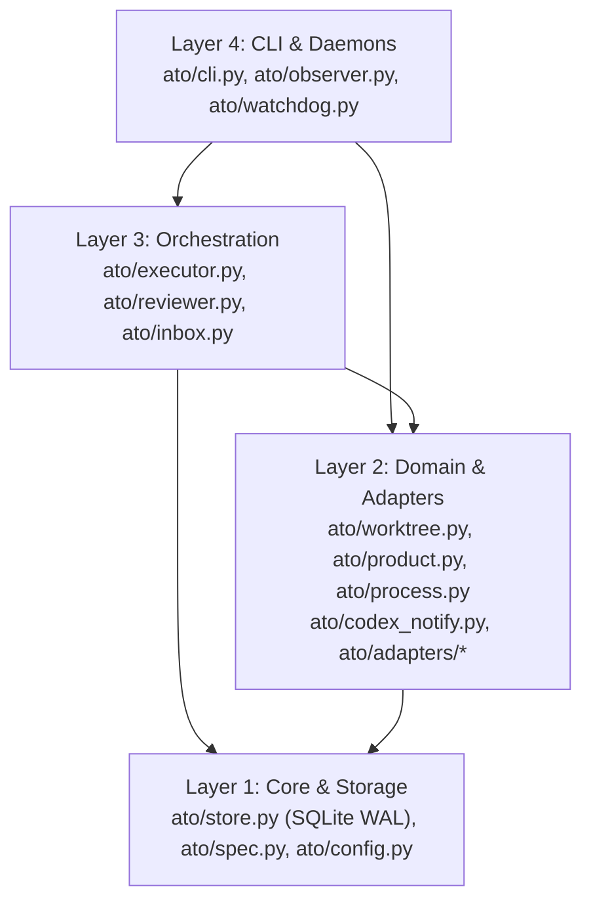

# ATO v2 Architecture

ATO v2 is a single Python package (`ato/`) organized as a strict 4-layer DAG with zero circular imports and zero mandatory third-party dependencies.

## Package Layers

## State Storage

All v2 runtime state lives under `$ATO_HOME/v2/` (default `~/.local/share/ato/v2/`):
- `ato.db` — SQLite WAL database (`tasks`, `runs`, `checks`, `reviews`, `questions`, `watchdog_state`, `watchdog_alerts`, `notifications`, `events`)
- `worktrees/<task_id>/` — isolated Git worktrees on branch `ato/<task_id>`
- `runtime/<task_id>/<run_id>/` — per-attempt logs, schemas, and sandbox profiles
- `observer.json` / `observer.lock` — background Observer heartbeat and single-instance lock
- `settings.json` — notification enablement, muted repositories, and advisory check settings

Legacy v1 data under `~/.local/share/ato/unified-v1/` is left untouched.

## Safety & Reliability Invariants

1. **Worktree isolation**: Workers never edit the primary checkout. `cleanup --confirm` commits verified product changes onto `ato/<task_id>` before removing the worktree.
2. **AGY/CLI default writable sandbox**: Codex workers default to `--sandbox workspace-write -c approval_policy="never"` unless overridden by a verified Codex controller session; read-only reviewers enforce `--sandbox read-only` or macOS `sandbox-exec`.
3. **Mutation tripwire**: `ato/reviewer.py` hashes the full worktree before and after every review turn and fails closed with `MUTATION_VIOLATION` if any file changed.
4. **PID-reuse-safe termination**: `ato/process.py` records process birth identities and probes child exit without reaping before signaling process groups.
5. **Non-blocking advisory Watchdog & notifications**: Completion, question, failure, and watchdog notices use independent deduplication keys in SQLite so advisory alerts never head-of-line block business notifications.
