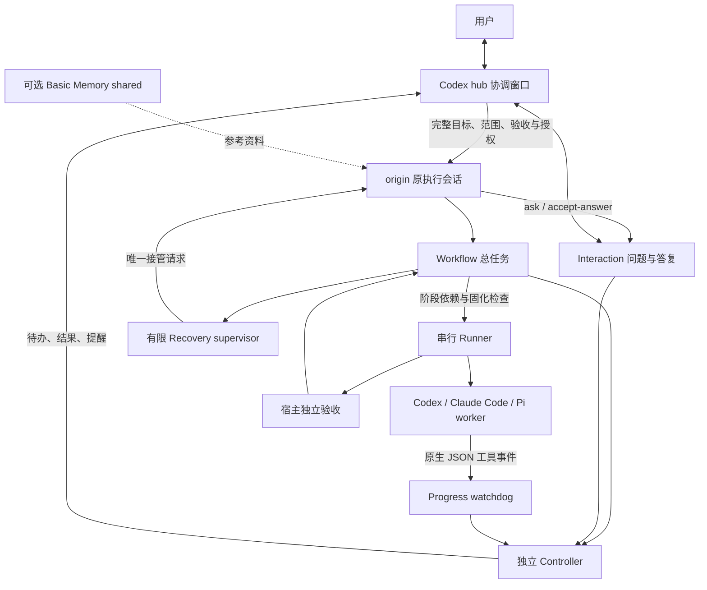
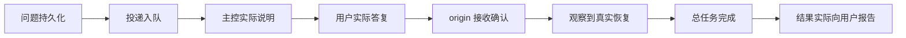

# 设计与实现

## 目标

用户通过一个协调窗口安排完整代码任务，模型主动澄清缺口并提出验收；范围明确后持续推进，前置依赖、独立验证、外部等待和有限修复由运行时约束。用户需要介入的问题集中到 hub，原执行会话保留工程上下文。模型的一轮结束、局部补丁完成、通知入队均不能代替完整目标验收。

不要求用户开启 `/goal`。模型负责需求与实现判断，确定性程序负责状态、期限、锁、检查命令、消息去重和可审计的推进证据。

## 组件与调用关系

| 模块 | 责任 | 不承担的责任 |
| --- | --- | --- |
| `runner.py` | 校验 DAG、阶段 worker、重试、进程组清理、仓库锁、宿主 checks | 不从 worker 的自述推断通过 |
| `workflow.py` | 完整合约、最终验收、阶段规划与累计预算、人工条件 | 不把新阶段当新总目标；不自行批准人工验收 |
| `recovery.py` | 有来源的有限接管、回复观察、证据登记与恢复 | 不无限修复或重置预算 |
| `interaction.py` | hub/origin 绑定、问题/答复 outbox、接收确认 | 不替用户决策，不迁移会话绑定 |
| `control.py` | 持久化待办、有限提醒、精确回复回传、结果待报告 | 不直接修改业务、不发放预算、不冒充已读 |
| `progress.py` | CLI 工具事件归一化、重复调用/无进展信号 | 不把告警等同于业务失败或自动取消依据 |
| `agents.py`、`pi-path-guard.mjs` | 第三方 CLI 协议、结果校验、受限文件工具 | 不管理任意已有第三方聊天窗口 |
| `delegation.py`、`appserver.py` | 显式新建持久化 origin 会话，接受后启动绑定 workflow | 不根据工程路径猜原会话或绕过已有处理者 |

## 三层任务状态

1. **完整 workflow**：`objective/scope/authorization/acceptance` 是完整约定。合约哈希保护检查定义；只有所有最终条件通过才 `completed`。
2. **阶段 run**：任务按依赖串行推进；worker 返回结构化结果，宿主执行独立 checks。`completion_scope=stage_only`。阶段完成后重查总体验收；未完成项在授权范围内规划下一阶段。
3. **会话/进程**：origin、某轮 worker、协调 hub 是不同身份。PID、实际开始事件、投递与响应分别记录，不能只看残留 `running` 或旧 PID。

总任务会在初验和每个阶段后复查全部条件，所以可能出现阶段曾通过、后续回归重新失败。人工条件用 `kind=manual`，只能依据用户实际验收登记。单次 check、worker 尝试、累计运行、阶段/规划次数均有有限上限，`resume` 不重置整体预算。

## 前置依赖与阻塞

任务计划用 `depends_on`，拒绝循环和不存在的依赖。失败分支阻塞下游；独立分支可继续。缺凭据、设备不可用和需要业务决策分别记录为阻塞/等待/人工输入，不当成实现缺陷反复重试。默认 check 通过 argv 执行，不隐式经过 shell。

需要新增验收或改变范围时保留旧合约并建立有来源的新约定，不能修改固化定义来通关。用户只给路径时仍由当前会话负责；只有明确要求独立会话才使用 `delegate`，新会话实际接受后再启动。

## 两种监督相互独立

**业务 supervisor** 有修复次数、同类失败次数、处理期限和监督窗口。它把唯一请求发回已核实 origin。origin 先登记 `working`，修复后登记真实证据及哈希；监督核实后恢复同一总任务。过期、冲突、发送不明或额度耗尽不能靠重新登记绕过。

**主控 controller** 继续观察已登记任务和问题，即使业务 supervisor 已退出。它独立保存待办和通知，不直接改业务，不因为用户暂时没回复就追加预算。运行时每5秒确定性读取状态与增量事件文件，检查本身不调用模型；通知唤醒后的模型诊断仍有成本。

当前登记入口是已配置 controller 时调用 `supervise`/首次启用 recovery，以及扫描绑定 hub 的现有问题。旧普通会话、无 origin 的 run、未登记 workflow、任意其他 CLI 交互窗口不会自动纳管。旧任务可在已有授权内重新 `supervise`，原额度和历史保持。

## 交互生命周期

`ctask inbox` 和 `followups` 只读。主控说明后显式 `presented --source`，这仍不是用户已读。`answer` 记录实际答复与来源，`accept-answer` 表示 origin 接收；二者都不能替代 `workflow_started`/执行代次推进。恢复待办关闭后，总任务仍继续观察。整体完成还产生独立的结果待报告项，向用户说明后才关闭。

停止、合约变化、origin 变化、后续执行代次和已解除阻塞会使旧问题失效。默认 hub 改变不重绑已投递问题。新的默认 controller hub 需要先停止旧 controller 并确认退出，旧待办和会话归属保留。

## 消息可靠性与结果回传

问题/答复使用本机 JSON 文件和锁保护；controller 使用 SQLite/WAL，事件与待办投影同事务写入。每条通知先写唯一 outbox claim 再调用 `codex queue`。多进程锁与唯一键去重；崩溃发生在发送与回执保存之间时保留不确定性，不能自动重试或换 ID 重发。

这提供的是持久化、至多发送一次的请求记录，**不是 exactly-once 投递或外部操作保证**。未知回执需要核查会话接收证据；重放日志不保证外部写操作没有重复。

新答复投递保存 origin rollout 偏移。controller 根据精确问题 ID 和轮次提取该轮最终回复并回传 hub，不取“最后一句”猜归属。历史消息无偏移时不猜测；同一 hub/origin 不自我转发。转回的文本是工作材料，不构成新用户授权。

默认每15分钟提醒，最多额外3次；达到提醒次数后未解决待办仍保留。未知消息不自动重发。controller 重启保留计数、投递与呈现状态，从现有问题、workflow 和 SQLite 投影继续核对；当前实现没有根据 controller 事件重放任意业务副作用的能力。

## CLI 事件适配

| 执行端 | 归一化输入 | 观察的含义 |
| --- | --- | --- |
| Codex exec | `item.started` / `item.completed` | 命令或工具开始/结束 |
| Claude Code | `assistant.tool_use` / `user.tool_result` | 工具身份和结果 |
| Pi | `tool_execution_start/update/end` | 工具开始、进度、结束 |

增量读取完整 JSONL，保留尚未完整写入的行。工具参数立即转成 hash 用于计数，不把参数正文复制到观察状态。默认同命令内6次相同参数工具、模型120秒无输出、工具600秒无进展分别告警并去重。原生格式升级需要重新验证；没有宣称所有版本完整兼容。

watchdog 仅观察模型 worker；安静的构建/宿主验收不按模型停滞处理。告警只要求核查真实进程和证据，不自动取消、抢占修改者或另开业务执行器。

## 预算推算与续办

预算申请先列出剩余诊断、修改、受影响回归、全部最终验收、交付和人工等待，给出历史实测/证据、预计重跑次数、可复用证据和不确定区间，再分别推算执行上限、监督窗口和接管次数。先定向诊断收敛候选，再跑昂贵全验。无新变更不重复全验；人工等待不伪装成持续执行。

当前没有通用自动预算追加 CLI、动态估算算法或无限自动批准。需要额外额度时，由用户决定或明确的每任务授权约束；不能把一个固定时长推广到全部任务。

预算承接可采用关联的新不可变合约，扣除旧已用/前台处理时间，保留旧验收和失败/修复账本。`followup-link` 只做观察关联：要求实际答复已由 origin 接收，工程、origin、完整目标与全部验收相同，scope 注释变化需核对结构化 lineage。旧 `blocked` 不能掩盖后继真实进展；新任务也不能掩盖旧用时或失败。

## 存储边界

| 数据 | 位置 | 是否适合共享到 GitHub |
| --- | --- | --- |
| 可复用实现、设计、测试、skill | 本仓库 | 是 |
| workflow、阶段、合约、检查证据 | 目标工程 `.codex/tasks/` | 否，包含任务上下文 |
| recovery 请求/额度/进程状态 | 对应 workflow 目录 | 否 |
| hub、问题、答复 | `CODEX_HOME/ctask-interaction/` | 否，本机会话绑定 |
| controller 事件/投影/outbox | 上述目录 `control/state.sqlite` | 否 |
| 可复用长期知识 | 可选 Basic Memory `shared` | 单独管理，不提交正文 |
| 模型账号与 key | 原生 CLI 配置/受信任环境 | 否 |

共享记忆是有来源的参考，不是新授权。源码跨机器复用不会复制旧会话 UUID、账号、知识库或实时任务。目标机独立配置 hub、认证和执行环境。

## 当前实现限制

没有开机自启、跨机器通知、网页面板、同一仓库多 worker 并发、任意第三方会话注入或自动无限预算。macOS 第三方文件工具 worker 不能等同于完整原生 Codex 沙箱。所有宿主检查必须在真实授权范围内；合约不能视作可直接运行的不可信输入。controller 是观察与路由层，机器休眠/关机期间不计算。

Pizza 的事件、回复回传和 watchdog 实现提供过设计参考；当前代码按本项目已有完整目标、有限接管与 hub 协议实现，没有安装 Pizza 或引入其 goal 调度器。

## User attention and execution coordination

Hub notification routing is independent of task status and operational delivery to origin. An opt-in `user_input_only` policy emits only current canonical pending questions; background states remain inspectable without creating conversation turns. Direct native queue ingress is a separate optional launcher boundary. Suppression never counts as presentation, approval, recovery or completion.

The existing generation-based host-handoff identity and explicit successor registration are separate mechanisms; quiet routing does not claim to fix their historical deduplication limits. A newly created workflow must be checked for controller observation and any explicitly authorized recovery configuration; watching an older predecessor does not automatically watch its successor.
