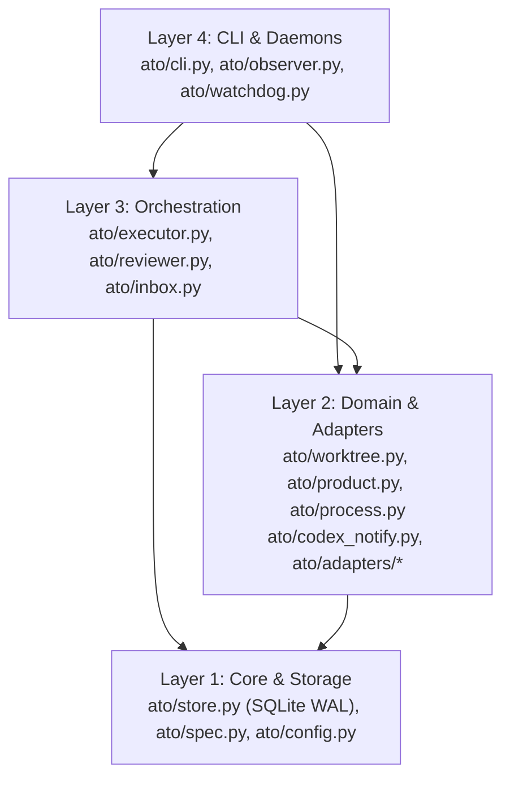

# ATO v2 Architecture

ATO v2 is a single Python package (`ato/`) organized as a strict 4-layer DAG with zero circular imports and zero mandatory third-party dependencies.

## Package Layers

## State Storage

All v2 runtime state lives under `$ATO_HOME/v2/` (default `~/.local/share/ato/v2/`):
- `ato.db` — SQLite WAL database (`tasks`, `runs`, `checks`, `reviews`, `questions`, `watchdog_state`, `watchdog_alerts`, `notifications`, `events`)
- `worktrees/<task_id>/` — isolated Git worktrees on branch `ato/<task_id>`
- `runtime/<task_id>/<run_id>/` — per-attempt logs, schemas, and sandbox profiles
- `observer.json` / `observer.lock` — background Observer heartbeat and single-instance lock
- `settings.json` — notification enablement, muted repositories, and legacy settings

Legacy v1 data under `~/.local/share/ato/unified-v1/` is left untouched.

## Safety & Reliability Invariants

1. **Worktree isolation**: Workers never edit the primary checkout. `cleanup --confirm` commits verified product changes onto `ato/<task_id>` before removing the worktree.
2. **AGY/CLI default writable sandbox**: Codex workers default to `--sandbox workspace-write -c approval_policy="never"` unless overridden by a verified Codex controller session; read-only reviewers enforce `--sandbox read-only` or macOS `sandbox-exec`.
3. **Mutation tripwire**: `ato/reviewer.py` hashes the full worktree before and after every review turn and fails closed with `MUTATION_VIOLATION` if any file changed.
4. **PID-reuse-safe termination**: `ato/process.py` records process birth identities and probes child exit without reaping before signaling process groups.
5. **Non-blocking advisory Watchdog & notifications**: Completion, question, failure, and watchdog notices use independent deduplication keys in SQLite so advisory alerts never head-of-line block business notifications.

## Verification evidence

Within each Run, the executor records a complete host verification round and
its bounded trace event in one SQLite transaction. A round is identified by Run
and attempt. Each criterion has a state, receipt ID, and compact failure
diagnostic. The latest round supplies the status checks and product check
digest. Public check history and `checks_finished` trace events omit command
arguments, output, and environment contents. The v2 migration adds nullable columns and a unique
index for new receipt rows. Legacy receipts retain unknown attempt identity
and their original stored evidence.

Review verdicts are bound to a product fingerprint and effective reviewer
configuration. A checks-only recheck can rely on a matching approval from a
completed Run. Reviewer mutation checks and ACP ownership, delivery, and
cleanup fences still gate settlement. Historical advisory completions are
interpreted at read time and can recover through a new Run.

Worker timeout streaks are derived from settled Run records with explicit worker
timeout evidence. The status diagnostic adds no notification stream. The
Watchdog retains its advisory alert and suppresses a second outgoing notice when
a failure notice already covers that check failure or timeout Run. Those notice
records are committed in the same transaction as the blocked settlement.

## Origin session delivery

The Observer dispatches session notices to verified Codex origins through the
Codex-specific `codex queue --thread … --message …` transport. AGY-origin
notices record `unsupported` and the session can query ATO status by Task ID.
[Observer routing](../ato/observer.py) · [Codex queue](../ato/codex_notify.py) · [Origin receipt](../ato/executor.py)

The dispatch audit observed that AGY's `--conversation` with `--print` starts an
agent turn. The existing AGY reviewer uses that active route to submit prompts.
The audit found daemon lifecycle operations in AGY's `remote-control` CLI and
no verified passive inbox transport. Passive same-session delivery requires a
supported AGY enqueue operation that verifies the target session, returns a
delivery receipt, and can enqueue without starting an agent turn. ATO would
need an adapter for that operation under its existing notification policy.
[AGY reviewer invocation](../ato/adapters/agy.py) · [Origin detection](../ato/config.py)
