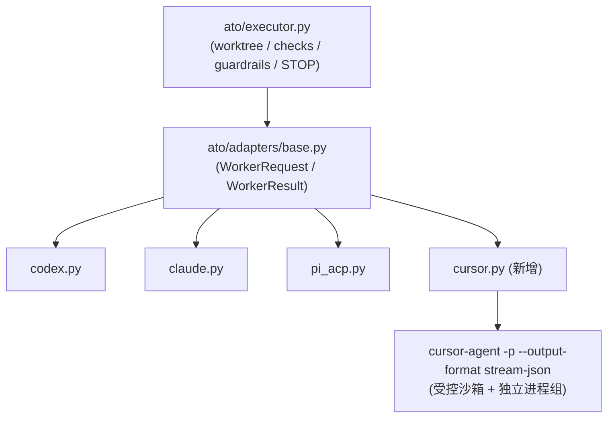

# Cursor Worker 接入 ATO v2 设计方案

- **状态**：已实现并验证（ATO v2 Cursor Worker；通过全量 38 项离线测试与本机真实 `cursor-agent` 端到端冒烟）
- **日期**：2026-11-26
- **适用基线**：ATO v2 (`main@2a8e7e7`, `ato 2.0.0`)；本机 Cursor Agent `2026.11.22-e9042b2` (`/Users/aias/.local/bin/cursor-agent`)
- **范围**：**仅接入 Cursor Worker**（不含 Cursor 托管主控、不重写调度/存储/Observer/Watchdog，不切换默认 Codex Worker）

---

## 1. 目标与边界

| 场景 | 目标行为 | 是否在本次范围 |
| --- | --- | --- |
| Codex / AGY / CLI → **Cursor Worker** | ATO 在隔离 Git worktree 中启动 Cursor Worker 执行单次任务，随后运行独立验收 checks | **是** |
| 普通 Cursor 终端调用 `ato run` | 通过 `ATO_SUBMISSION_KIND=cursor` 抑制误读环境变量 `CODEX_THREAD_ID`，通知状态保持 `unsupported` | **是**（~5 行配置兼容） |
| 只读 Cursor Reviewer（`--mode plan` + worktree 绊线） | 可选复用同一适配器提供只读评审 | 可选扩展（~50 行） |
| Cursor 托管主控 / 接管已打开 Cursor 会话 / 回调注入 | 不涉及长驻多轮宿主与通知注入 | **否（已移除）** |

**核心原则**：ATO 继续完全拥有 worktree 隔离、执行锁、累计尝试次数、独立 host checks、opt-in `guardrails`、`STOP` 进程组清理与 SQLite 状态落盘。Cursor Worker 仅负责在受限沙箱内完成单轮执行并返回符合 `WORKER_RESULT_SCHEMA` 的结构化结果，不拥有任务完成判定权。

---

## 2. 本机只读核对事实与前置 Spike 项

### 2.1 已核对事实（零模型调用）
- 本机安装路径：`/Users/aias/.local/bin/cursor-agent`（`agent` 为指向同一二进制的软链），版本 `2026.11.22-e9042b2`，`cursor-agent status` 已登录。
- `cursor-agent --version` 在 macOS `/usr/bin/sandbox-exec` 只读配置下可正常启动并退出码为 `0`。
- `cursor-agent -p` 原生支持 `--output-format stream-json`、`--workspace`、`--trust`、`--model`（含参数化写法如 `claude-opus-4-8[context=1m,effort=high,fast=false]`）、`--sandbox enabled|disabled`、`--mode plan|ask`、`--force`。
- `cursor-agent acp` 仅支持 `-h/--help`，`initialize` 握手返回 `protocolVersion: 1` 与 `cursor_login`，无独立 CLI 参数指定模型或沙箱。

### 2.2 编码前需确认的 3 个小探针（Spike）
1. **沙箱兼容性**：真实执行 `cursor-agent -p` 时，开启 `--sandbox enabled` 是否与外层 macOS `sandbox-exec` 发生 Seatbelt 嵌套冲突；如果冲突，确认是「仅用外层 `sandbox-exec` + `--sandbox disabled`」还是「仅用原生 `--sandbox enabled`」。
2. **原生状态目录最小写权限**：核验 `cursor-agent -p` 执行期间对 `~/.cursor/`（如 `chats/`、`projects/`、`statsig-cache.json`）的最小写入需求，确保不泄露也不污染其他工程。
3. **stream-json 终态事件结构**：抓取一次真实 `cursor-agent -p --output-format stream-json` 正常结束、认证失败、模型报错与 `SIGTERM` 中断时的 JSONL 事件格式，确定解析规则。

---

## 3. 架构与接入通道选型

在 ATO v2 中，[ato/adapters/base.py](../ato/adapters/base.py) 已提供厂商无关的 `WorkerRequest -> WorkerResult` 接口，无需改造核心执行器 [ato/executor.py](../ato/executor.py) 或 [ato/store.py](../ato/store.py)。



### 通道选型：默认采用 `-p --output-format stream-json`（保留 ACP 备选）

| 维度 | 方案 A（推荐）：`cursor-agent -p --output-format stream-json` | 方案 B（备选）：`cursor-agent acp` |
| --- | --- | --- |
| 依赖要求 | **零第三方依赖**（仅 Python 标准库） | 依赖可选包 `agent-client-protocol` |
| 参数控制 | 原生支持 `--workspace` / `--model` / `--mode` / `--sandbox` / `--trust` | `acp` 子命令无 CLI 参数，需通过协议能力协商 |
| 架构一致性 | 与 [ato/adapters/claude.py](../ato/adapters/claude.py) 完全同构 | 需维护异步 ACP 客户端与权限回调 |
| 适用场景 | **一次性单轮 Worker（完美匹配）** | 仅在未来需要细粒度工具拦截或长驻多轮会话时启用 |

---

## 4. Cursor Worker 详细设计

### 4.1 任务配置与模型标识

任务 spec 沿用 `schema_version: 1` 的 `worker_contract.agent`：

```json
{
  "worker_contract": {
    "agent": {
      "kind": "cursor",
      "model": "sonnet-4-thinking"
    }
  }
}
```

- 可执行文件解析顺序：`ATO_CURSOR_BIN` → `CTASK_CURSOR_BIN` → `shutil.which("cursor-agent")`（**避免直接解析裸 `agent` 引发同名 CLI 碰撞**）。
- [ato/spec.py](../ato/spec.py) 中的 `MODEL_RE` 扩展允许方括号参数语法 `[key=val,...]`（仅限安全字符集，仍拒绝空白、引号、控制字符和 `-` 开头）。
- **禁止**让 Cursor 使用 `-w/--worktree` 创建第二层 worktree；始终绑定 ATO 创建的 `req.worktree`。

### 4.2 权限、沙箱与环境清洗

| `req.sandbox` | 启动参数与隔离边界 |
| --- | --- |
| `read-only` | `--mode plan`（只读分析）+ 外层 `sandbox-exec` 禁止写入 `req.worktree`（仅允许 `runtime_dir` 与必需缓存） |
| `workspace-write` | `--workspace <req.worktree> --trust --force` + 外层 `sandbox-exec`（或经 Spike 确认的原生沙箱），仅允许写入 `req.worktree`（排除 `.git/.codex/.ato/.cursor/.pi/.aws/.ssh/.env`）与 `runtime_dir` |

- **不调用交互别名 `anb`**，直接执行已解析的可信可执行文件。
- 清洗跨厂商会话环境变量：`CODEX_THREAD_ID`、`ATO_SUBMISSION_KIND`、`ANTIGRAVITY_CONVERSATION_ID`、`ATO_ACTOR_FILE`。
- 不复制个人 `~/.cursor` 目录，不将 `CURSOR_API_KEY` 写入任务记录、argv 或日志，输出落盘前走 `secret_values()` / `has_secret()` 脱敏检测。

### 4.3 结构化输出提取与校验

由于 `cursor-agent -p` 没有 `--output-schema` 参数，采用明确的二段式提取与严格校验：

1. 在 prompt 末尾附带 `WORKER_RESULT_SCHEMA`，要求模型最终回复仅输出一个匹配 JSON 对象（字段：`status`、`summary`、`blocker`、`next_step`）。
2. 从 `stream-json` 终态助手消息中解析：
   - 优先整体 `json.loads()`；
   - 若包含唯一 ` ```json ... ``` ` 代码块则提取块内文本再解析；
   - 必须通过 `base.validate_worker_result()` 严格校验；**不把正常退出码或自由文本当作结构化成功结果**。
3. 若解析失败且未耗尽 `max_attempts`，返回 `WorkerResult(status="failed", ...)` 交由 `executor.py` 带错误反馈重试，不篡改任务验收逻辑。

### 4.4 错误分类与 STOP

| 异常情形 | 归类为 `WorkerResult` | 后续行为 |
| --- | --- | --- |
| 未安装 `cursor-agent` | `status="blocked", blocker="EXECUTABLE_UNAVAILABLE"` | 立即停止重试，提示安装 |
| 未登录 / 鉴权失败 | `status="blocked", blocker="AUTH_BLOCKED"` | 立即停止重试，提示运行 `cursor-agent login` |
| 配额 / 限流 / 服务不可用 | `status="blocked", blocker="PROVIDER_UNAVAILABLE"` | 不消耗代码修复重试次数 |
| 用户触发 `ato stop` | `status="blocked", blocker="STOPPED"` | `run_bounded_subprocess()` 通过 `terminate_popen()` 终止整个进程组（先 `SIGTERM` 再 `SIGKILL`，无 PID 复用误杀） |
| 超时 | `status="blocked", blocker="TIMEOUT"` | 终止整个进程组并落盘 stderr |
| 模型需要人工决策 | `status="needs_input"` | 退出 Worker 进程，自动进入 `ato inbox` → `ato answer` → `ato resume`（绝不在后台挂起死等） |
| 协议/JSON 畸形或非零退出 | `status="failed"` | 计入 `max_attempts` 有界重试 |

---

## 5. ATO v2 改造清单（预计 ~220 行代码）

| 文件 | 改动内容 | 预计增量 |
| --- | --- | ---: |
| `ato/adapters/cursor.py`（新增） | `run_worker()`、argv 构造、stream-json 解码、错误归类、沙箱封装（可选附带只读 `run_review()`） | ~180–220 行 |
| [ato/spec.py](../ato/spec.py) | `WORKER_KINDS` 加入 `"cursor"`；放宽 `MODEL_RE` 兼容 `[k=v]` 参数化模型名 | ~6 行 |
| [ato/config.py](../ato/config.py) | `resolve_executable("cursor")` 优先查找 `cursor-agent`；`detect_submission_origin()` 识别 `ATO_SUBMISSION_KIND=cursor` | ~12 行 |
| [ato/adapters/base.py](../ato/adapters/base.py) | `get_worker_runner("cursor")` 路由；`doctor_all()` 增加 `cursor` 探测 | ~8 行 |
| `tests/test_cursor_adapter.py`（新增） | 离线合成桩测试（正常/重试/认证失败/只读越界/STOP 进程组清理/参数化模型校验） | ~150 行 |
| [docs/cli-and-spec.md](cli-and-spec.md) | 补充 `agent.kind = "cursor"` 说明 | ~5 行 |

**零改动模块**：`ato/store.py`、`ato/executor.py`、`ato/observer.py`、`ato/watchdog.py`、`ato/inbox.py`、`ato/worktree.py`、`ato/product.py`、`ato/cli.py`。

---

## 6. 验证清单

### 6.1 离线自动化测试（无真实模型调用）
- `ATO_CURSOR_BIN` 指向合成脚本：覆盖 `completed`、`blocked`（未登录/限流）、`needs_input`（进 `inbox` → `answer` → `resume`）、`failed`（JSON 畸形/非零退出）、`STOP` 与超时进程组清理。
- 校验 `read-only` 与 `workspace-write` 沙箱 profile 排除 `.git` / `.cursor` / `.ato` / `.env`，不泄漏环境变量密钥。
- 校验 `ATO_SUBMISSION_KIND=cursor` 不会继承环境中的 `CODEX_THREAD_ID`。
- 校验 `ato agent doctor` 正确报告 `cursor` 安装状态。

### 6.2 真实 Cursor Worker 冒烟验收（按需执行）
- 在临时 `ATO_HOME` 与临时 Git 仓库中运行 `ato run --foreground`（`agent.kind = "cursor"`）：
  1. 在隔离 worktree 内按要求创建/修改文件；
  2. 独立 host checks 通过，`ato project diff --stat` 与预期一致；
  3. 验证 `ato stop` 后无残留 `cursor-agent` 子进程；
  4. `ato project cleanup --confirm` 干净回收 worktree。
