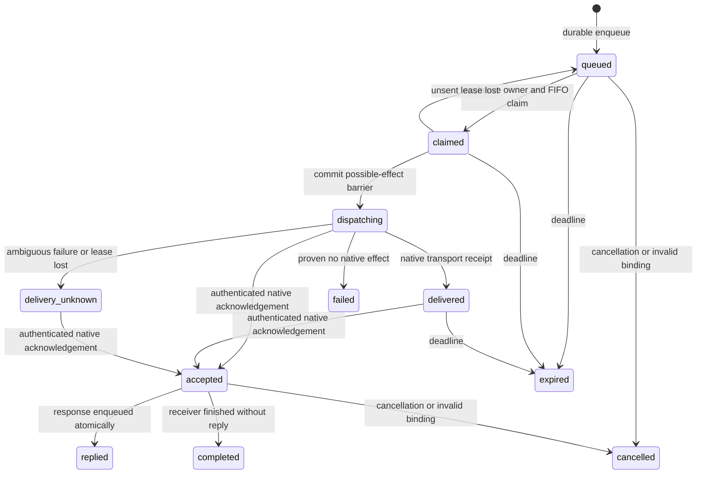

# Persistent message protocol (v1)

The primitives live in `message_bus.py`; the adapter boundary is `transport.py`.
`mailbox_routes.py` now connects interaction, recovery, controller and delegation
to that shared API. Existing JSON decisions, origin UUIDs, budgets and recovery
history remain authoritative; they are not imported as new deliveries. This is local source delivery, not live runtime activation or completion
of the [whole task](agent-neutral-mailbox-task.md). Offline staging and legacy
compatibility/rollback tooling are in `scripts/upgrade_runtime.py`; see
[runtime-upgrade.md](runtime-upgrade.md) and the current
[validation record](message-delivery-validation.md). Final host qualification
remains independent of worker evidence.

## Store and trust boundary

`MessageBus(path)` requires an explicit, separate local SQLite path. It does not
read `CODEX_HOME`, native auth/config, hub data or task history. There is no daemon,
implicit CLI call, scheduler, model wake-up or environment-derived identity.
New store files are mode `0600`; newly created containing directories are `0700`.
Existing file modes are preserved. WAL, `synchronous=FULL`, foreign keys, unique
constraints and `BEGIN IMMEDIATE` protect multi-process updates. Connections close
after each operation. `PRAGMA user_version=1` identifies this schema; unknown
versions fail rather than being downgraded. Do not pass a legacy controller DB
as this path. This is a local same-user trust boundary, not a network service or
protection against an actor who can edit the database.

| Table | Durable contents |
| --- | --- |
| `endpoints` | Immutable ID, transport kind, native session ID, canonical existing project directory, verification source, hashed capability, state and exclusive owner lease |
| `bindings` | Directional sender/target, exact task ID and contract hash, routing instruction source and state |
| `messages` | FIFO sequence, stable message ID, sender/target, binding, kind, correlation/reply IDs, task/contract provenance, idempotency key/hash, state/timestamps, claim and dispatch attempt, native receipt ID |
| `bodies` | Message text, separate from routing and identity |
| `events` | Ordered transactional registration, routing, enqueue, claim, dispatch, receipt, state and reconciliation history |
| `receipts` | Per-endpoint native receipt deduplication, message ID, kind, fingerprint, late flag and time |
| `receipt_bodies` | Receiver response text, including late replies quarantined after cancellation/expiry |

`register_endpoint(endpoint_id, kind=..., session_id=..., project=..., source=...)`
is a trusted host operation. It returns an `EndpointCredential` containing the
endpoint ID, exact native session ID, canonical project and a random local
capability. Only its hash is stored. The host must persist the capability in its
private managed-endpoint state, **outside message bodies and model input**, for
reuse across restarts. It is not a native provider key. The bus never imports
native credentials. Lost capabilities cannot be recovered from the hash or by
silently re-registering a session. Endpoint IDs and `(kind, session_id)` are
unique, preventing a second project binding for one native session. Registration
evidence must come from native verification by the host; model text is not
proof. The bus does not independently inspect CLIs.

Sender and receiver APIs authenticate the capability and compare session/project
exactly. `endpoint(id)` omits credential hashes and owner tokens. Identities are
immutable; `set_endpoint_state(credential, state, source=...)` changes only
`active`/`paused`/`closed`. Closed identities cannot reopen. Pausing cancels
existing pending turns; resuming does not revive those messages.

## Explicit routes and provenance

`bind_route(sender=..., target=..., task_id=..., contract_hash=..., source=...)`
records permission to **route work material**. Every enqueue must match those
identity/contract fields. Crossing project directories additionally requires the
trusted host to pass `cross_project=True` with explicit evidence, such as a
verified hub binding. It is never inferred from a UUID or nearby directory.
This does not authorize a workflow, grant tools, approve user decisions, replenish
budgets or modify acceptance conditions.

`set_binding_state(binding_id, 'paused'|'stopped'|'superseded', source=...)`
invalidates unsent and in-flight work. Invalidation is deliberately irreversible
for that route: a changed contract needs a new explicit binding. Integration
must check canonical workflow STOP/state/generation/contract and user deferral
before enqueue **and again before dispatch**, and invalidate on change. The bus
does not read workflow state or independently know a task stopped. The source
framework must preserve its existing budget and authorization ledger.

## Message lifecycle



Cancellation and expiry apply to every nonterminal state, including dispatching
and unknown delivery. `completed` means **this message's native turn finished**,
not that a workflow passed acceptance or a result was presented to the user.
Transport `delivered`, receiver `accepted`, reply, real execution, user permission
and workflow completion remain separate facts.

`enqueue(credential, binding_id=..., target=..., kind=..., body=...,
idempotency_key=..., task_id=..., contract_hash=..., correlation_id=None,
expires_at=None)` commits the envelope, body and event together. The server
generates `msg-...` IDs. A root message defaults its correlation ID to its ID;
replies carry the original correlation ID and an exact `reply_to`. Input text
is limited to 1 MiB. No executable meaning is attached to `kind` or body.

Idempotency is scoped to `(sender, idempotency_key)`. Exact retries return the
original message, even after route invalidation, without triggering another
send. Reusing a key with changed body/route/kind/expiry/correlation raises
`ConflictError`. After caller restart, reuse its persisted key and original
inputs instead of generating new deadlines/IDs. The generated default correlation
ID is not part of that input fingerprint.

`expires_at` is an absolute finite Unix timestamp. `recover()` records expiry
events and stale claims explicitly; ownership acquisition, claim and receiver/
delivery operations also invoke recovery. Read-only `message()`, `events()` and
`receipts()` do not advance deadlines. There is no automatic clock loop. Pending
messages survive process exit/restart without reading native history.

## Ownership, serial delivery and failure semantics

The managed host calls `acquire_endpoint(credential, owner=..., lease_seconds=30)`
and receives a fencing token. Another live owner is rejected even with the same
label. `renew_endpoint` extends it; `release_endpoint` relinquishes it. Expired
owners cannot renew or initiate dispatch. Replacement owners must still verify
the native process/session before attaching; a SQLite lease does not kill a
process or prove its absence. Owner labels are evidence, not OS process locks.

`claim(credential, owner_token, lease_seconds=30)` returns the oldest queued
message or `None` when empty/busy. A unique partial index enforces one busy
message per receiving endpoint across processes. The claim deadline cannot
exceed the ownership deadline. `begin_dispatch(credential, owner_token,
message_id, claim_token)` checks the current route, endpoint, deadline, claim and
owner, then **commits** `dispatching` and an `attempt_id`. Only after it returns
may an adapter send. A stale claim cannot send after recovery.

`finish_dispatch(message_id, attempt_id, state=..., external_id=None)` records
the transport receipt. Legal states are `delivered`, `delivery_unknown`, and
`failed`. `failed` requires positive evidence of **no native effect**; a timeout
after writing a pipe is unknown. Identical duplicate receipts are idempotent;
conflicting receipts for an attempt are rejected. Late receipts cannot revert
receiver acceptance or revive terminal work. Keep the attempt capability private.

An unsent expired claim can return to FIFO `queued`. After the dispatch barrier,
lost ownership, process death, an exception or timeout leaves
`delivery_unknown`, **never automatically queued again**. This includes the
window between committing the barrier and invoking the CLI. There is no
exactly-once guarantee. A durable mailbox does not guarantee model execution.

`delivered`, `accepted` and `delivery_unknown` occupy the endpoint slot until
an explicit reply or receiver completion. Unsent cancellation/expiry releases
it. Cancellation/expiry after possible native effect preserves a quarantine
slot to prevent overlap with an unverified live turn. After checking native
evidence, the receiving host may call `reconcile(credential, message_id,
source=..., outcome='not_running'|'finished')`. This releases the slot without
resending or reopening cancelled/expired work. Unknown delivery becomes
`failed`/`completed`. An unknown receipt alone is not reconciliation evidence.

## Receiver acknowledgements and atomic replies

After correlating an exact native message/session, a host calls:

```python
bus.accept(receiver, message_id, receipt_id='native-turn:accepted')
reply = bus.reply(receiver, message_id, receipt_id='native-turn:reply',
                 body='The actual correlated response')
# Or, when no reply is required:
bus.complete(receiver, message_id, receipt_id='native-turn:completed')
```

Acceptance is required before reply/completion. It may arrive before the native
transport receipt without regressing state. Reply creation, original turn
completion, serial-slot release and a new response envelope commit in one
transaction. The response reverses the original endpoint pair using that exact
task/contract binding, without granting an unrelated route. It remains FIFO
work at the original sender; its receiving host must consume and finish it.
The bus does not silently redispatch reply messages to that sender's own model.

Receipt deduplication is scoped to `(receiving endpoint, receipt_id)` with a
content fingerprint. Duplicates cannot create a second reply, even across
processes. After expiry/STOP/contract invalidation, a late response is persisted
in `receipt_bodies` with `late=1`, but `reply()` returns `None` and creates no
actionable work. `cancel(sender, message_id, source=...)` is sender-only and
preserves original contents/history. No model response manufactures a user answer.

## Verification

See [`agent-transports.md`](agent-transports.md) for adapter APIs. The
deterministic suite uses real SQLite files and spawned processes, including hard
exits before send, after the dispatch barrier, after a local fixture effect and
inside an uncommitted transaction:

```sh
python3.12 -m unittest discover -s tests -p test_message_bus.py -v
```

These tests establish storage, identity, FIFO, fencing, deduplication, crash and
late-response behavior. They do not qualify native CLIs/providers, change live
hub routing, or replace the remaining full-goal acceptance criteria.

## Workflow host integration

The workflow host explicitly selects `CODEX_HOME/ctask-interaction/mailbox/`:
`messages.sqlite` stores envelopes, receipts and workflow guards; private `0600`
registry manifests store host capabilities separately from message text. The
standalone `MessageBus(path)` continues to require an explicit path and has no
environment lookup. Legacy question JSON and controller outbox claims are still
checked first. A preexisting `dispatching`, unknown or delivered claim is never
turned into a fresh send after restart. New JSON delivery records add `mailbox_id`
while preserving native `message_id`, thread labels and rollout offsets.

Managed workflow origins add `origin_endpoint_id`; `origin_thread_id` remains
null for a new managed origin and remains the original UUID for old Codex data.
Both fields set simultaneously fail verification. Managed capabilities bind the
exact native session and project. Codex keeps exact session-index/metadata
verification; a recorded native working directory must match the origin project.
Older metadata without a cwd continues to use the legacy index verification.
There is no latest-session or whole-history identity inference.

`workflow_guards` records each envelope's canonical workflow generation, origin
and notification category. The host checks the unchanged contract hash, origin,
STOP, endpoint state, generation, workflow state and recovery request expiry
before a native turn and before applying its receipts. A crash between enqueue
and guard persistence fails closed. Stopped, expired or stale receipts remain
in the audit trail and cannot revive a question, workflow or cancelled message.
Endpoint pause cancels pending work; making it active does not replay cancelled
messages. Disabling supervision fences recovery requests without discarding the
actual user's separate question/answer flow. No budget or takeover limit resets.

The native adapters hold one turn slot until correlated reply/completion. Codex
instead owns a persistent native queue: after its enqueue subprocess is reaped,
`queued_natively()` releases the host enqueue slot for distinct notifications,
including after an unknown receipt. The original unknown envelope is never
resent. The mailbox records whether the enqueue receipt was known; neither case
asserts model acceptance or a completed turn. A process crash at the dispatch
barrier remains quarantined. Cancelling/expiring old deliveries cannot recreate
an already released slot.

`project_reply()` records trusted workflow-host receipt of a correlated native
reply without launching another model turn. It keeps the body and reply linkage
for the controller; raw replies do not accidentally become a second native send.
Controller relay, presentation, user decision, origin acceptance, execution and
whole-workflow acceptance are independent records. Framework-generated questions
are task material. They cannot synthesize `answer_source` or user authorization.


## Compatibility and rollback

Old origin UUIDs, workflow JSON, question/answer records, controller tables and
unknown outboxes are read in place, without conversion into new bus sends. The
mailbox/registry is additive; its capabilities and native transcripts must be
retained privately across host restart. Migration rehearsals in
`tests/test_upgrade_runtime.py` snapshot temporary old records, reopen controller
claims twice, create a separate mailbox, and restore to a new destination while
preserving STOP, cumulative time, failed acceptance and recovery limits/history.

The dry-run never opens state databases. Optional snapshots require offline owners
and no SQLite sidecars; restore verifies hashes and never writes original paths.
Neither command imports identities into another machine or rewrites paths. An old
runtime cannot operate new managed origins. Do not downgrade an active managed
workflow or restore a historical snapshot over later usage/decision records; see
[runtime-upgrade.md](runtime-upgrade.md) for the explicit rollback boundary.
